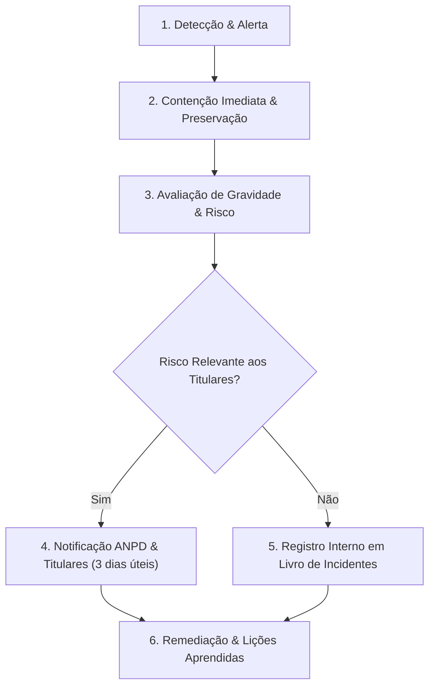

# Plano de Resposta a Incidentes de Segurança com Dados Pessoais — Conecta Móveis

**Em conformidade com a LGPD (Lei 13.709/2018) e a Resolução CD/ANPD nº 15/2024.**  
**Canal de Comunicação de Incidentes:** `seguranca@conectamoveis.com.br`  
**Responsável Técnico:** Equipe de Engenharia e Operador da Conecta Móveis.

---

## 1. Definição de Incidente de Segurança
Qualquer evento confirmado ou sob suspeita fundada que acarrete destruição, perda, alteração, divulgação ou acesso não autorizado a dados pessoais tratados no âmbito da Conecta Móveis.

---

## 2. Fases de Resposta a Incidentes

### Fase 1: Detecção e Triagem Inicial
- **Canais de entrada:** Alertas do monitoramento de infraestrutura (Vercel/Supabase), relatos de usuários, notificações de pesquisadores de segurança ou alertas do DPO.
- **Registro do Incidente:** Abertura imediata de chamado com carimbo de data, hora e responsável técnico.

### Fase 2: Contenção e Preservação de Evidências
- Revogação de chaves comprometidas (Supabase Service Role, Vercel tokens, SMTP);
- Isolamento de tabelas ou buckets atacados;
- Preservação de logs brutos e dumps forenses antes de qualquer alteração corretiva.

### Fase 3: Avaliação de Risco e Gravidade (Critérios ANPD Res. 15/2024)
- **Natureza dos dados:** Dados de contato, mensagens privadas ou registros de conexão?
- **Volume:** Quantidade de titulares atingidos;
- **Consequências potenciais:** Risco de estelionato, phishing direcionado, exposição indevida ou danos materiais/morais.

### Fase 4: Comunicação à ANPD e aos Titulares
Conforme o art. 9º da Resolução CD/ANPD nº 15/2024, a comunicação à autoridade nacional e aos titulares afetados deve ser realizada no prazo de **3 (três) dias úteis**, contados a partir do conhecimento de que o incidente afeta de forma relevante a segurança jurídica ou direitos dos titulares.

#### Conteúdo Obrigatório da Notificação:
1. Descrição clara da natureza do incidente;
2. Categorias e dados pessoais afetados;
3. Medidas técnicas e de segurança adotadas para conter e mitigar o incidente;
4. Riscos identificados para os titulares;
5. Recomendações aos titulares para proteção própria (ex: alteração de senhas);
6. Contato do Encarregado pelo Tratamento de Dados Pessoais (DPO).

---

## 3. Modelo Padronizado de Comunicação aos Titulares

> **Assunto:** [COMUNICADO DE SEGURANÇA] Informações sobre incidente com dados pessoais — Conecta Móveis
>
> Prezado(a) usuário(a),
>
> Em conformidade com o art. 48 da Lei Geral de Proteção de Dados (LGPD) e as diretrizes da ANPD, informamos que em [DATA/HORA] identificamos [BREVE DESCRIÇÃO DO FATO, EX: acesso não autorizado a dados cadastrais].
>
> **Quais dados foram afetados:** [LISTA ESPECÍFICA, EX: Nome e e-mail cadastrado]. Senhas criptografadas e dados financeiros não foram acessados.
>
> **O que fizemos:** Nossas defesas revogaram os acessos indevidos imediatamente, aplicamos correções na infraestrutura e notificamos a Autoridade Nacional de Proteção de Dados (ANPD).
>
> **O que você deve fazer:** Recomendamos por cautela que [AÇÃO RECOMENDADA, EX: redefina sua senha de acesso na plataforma].
>
> Em caso de dúvidas, nosso canal de privacidade está à disposição: `privacidade@conectamoveis.com.br`.

---

## 4. Livro de Registro de Incidentes (Auditoria Obrigatória)

| Protocolo | Data / Hora | Categoria | Titulares Afetados | Medida Adotada | Notificação ANPD | Status |
| :--- | :--- | :--- | :--- | :--- | :--- | :--- |
| `INC-2026-001` | [Exemplo] | Tentativa de brute force em login | 0 (bloqueado por rate limit) | Bloqueio de IP por 24h | Dispensada (sem vazamento) | Fechado |

